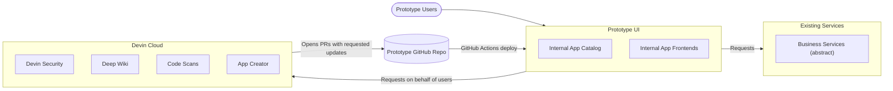
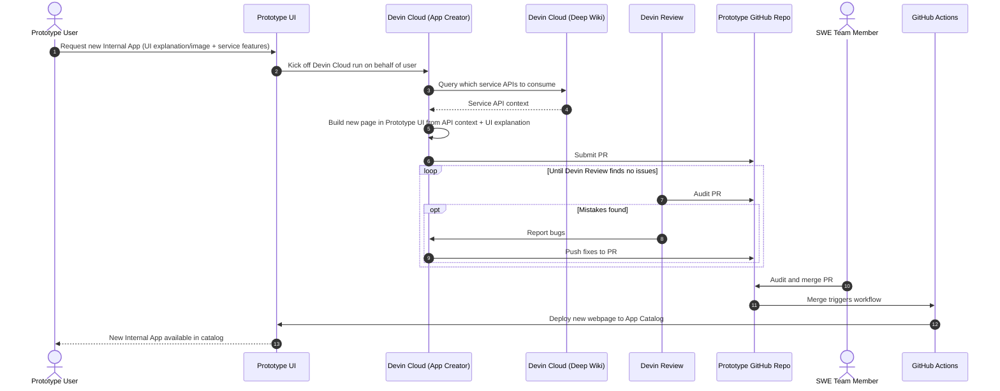

# DevinPowerApps

An internal App Catalog where users request new apps and Devin builds them as PRs to this repo.
It runs locally as a demo MVP.

## What runs now

1. App Catalog at `/`: one card per internal app, built from each app's `app.json` manifest.
2. Service Health at `/apps/service-health`: shows each internal service as up or down.
   It is the reference pattern Devin copies for new apps.
3. A mock Feature Flags service on port 4001 that stores true/false flags in SQLite.
   Its API is documented in `docs/services/feature-flags.md`.

Sign-in, access control, and the App Creator are planned in `docs/plans/2026-10-26-powerapps-mvp.md`.

## Run it

1. Install Node 24 or newer.
2. `npm ci`
3. Optional: `cp .env.example .env` to change ports or the service URL.
4. `npm run dev` starts the Feature Flags service and Next.js together.
   Open http://localhost:3000.

## Checks

1. `npm run lint`
2. `npm run typecheck`
3. `npm test` boots the Feature Flags service and the dev server, then checks flag CRUD, the catalog, and Service Health.
4. `npm run build`

CI runs all four on every PR (`.github/workflows/ci.yml`).

## File structure

1. `src/app/`: Next.js App Router pages and the root layout.
2. `src/app/apps/<slug>/`: one folder per internal app, with `page.tsx` and an `app.json` manifest (name, description, owner, services).
3. `src/lib/catalog.ts`: reads the app manifests.
4. `src/lib/services.ts`: the list of internal services with base URL and API doc path.
5. `services/feature-flags/server.ts`: the mock Feature Flags service.
6. `tests/`: smoke tests run with `node:test`.
7. `docs/plans/`: executed agentic plans.
8. `docs/services/`: API docs for internal services, which Devin reads when building apps.
9. `docs/notes.md`: gotchas, rejected approaches, and deferred work.
10. `AGENTS.md`: rules for agents working in this repo.

## Target design

### Basic Details

1. Webpage that you can create new Apps from
    1. Internal App Catalog that showcases all of the available apps to use
    2. New App Creator
        1. Provide UI explanation or screenshot
        2. Connect to internal wikis and other documentation to access the correct APIs for a given internal service to surface data
        3. Kick off devin runs to create the actual application
            1. Utilize the Devin API
            2. Create a Pull request in the repo
    3. Security
        1. Have access control panel to determine which users have access to a given app
        2. Use your existing SSO solution
        3. Enable cron schedule for running Devin Security for fixes

### Architecture

High Level

App Creation - Sequence Diagram

