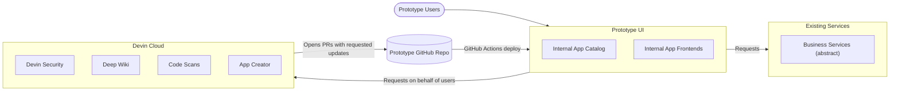
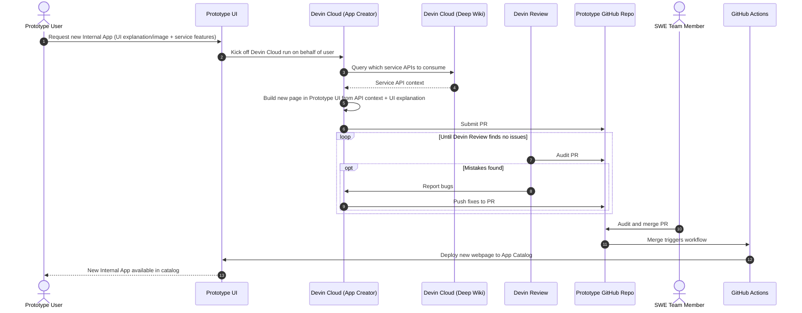

# Notes

Gotchas, rejected approaches, deferred work, and the target design for DevinPowerApps.
Owner: spvyerra.

## Gotchas

`next dev` in Next.js 16 writes a managed block into the root `AGENTS.md` when it detects an AI agent.
That block contains em dashes, which this repo bans, so `next.config.ts` sets `agentRules: false`.
The useful part of that block, reading `node_modules/next/dist/docs/` before writing Next.js code, lives in `AGENTS.md` as a plain rule.

`npm run typecheck` runs `next typegen` first, because route types such as `LayoutProps` are generated and `tsc` alone cannot see them.

Tests run TypeScript directly through Node 24 type stripping, so test files must use erasable syntax only (no enums or namespaces).

## Rejected approaches

Google fonts through `next/font/google` were dropped from the scaffold, because they need network access at build time and the MVP runs locally.

## Deferred

Cloud hosting and a deploy workflow wait until a hosting target is chosen.
Devin API calls wait on a Devin service-user API key.

## Target design

The full product this MVP grows into.
Phases beyond the current plan are listed under Later phases in `docs/plans/2026-10-26-powerapps-mvp.md`.

### Basic Details

1. Webpage that you can create new Apps from
    1. Internal App Catalog that showcases all of the available apps to use
    2. New App Creator
        1. Provide UI explanation or screenshot
        2. Connect to internal wikis and other documentation to access the correct APIs for a given internal service to surface data
        3. Kick off devin runs to create the actual application
            1. Utilize the Devin API
            2. Create a Pull request in the repo
    3. Security
        1. Have access control panel to determine which users have access to a given app
        2. Use your existing SSO solution
        3. Enable cron schedule for running Devin Security for fixes

### Architecture

High Level

App Creation - Sequence Diagram

