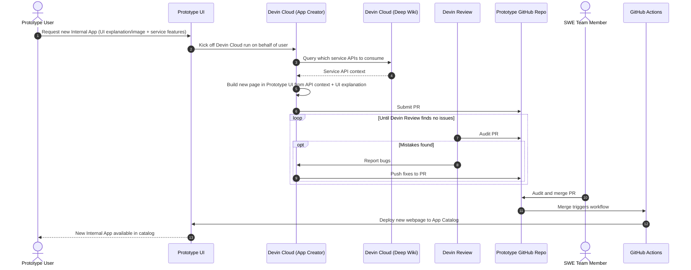

# Notes

Gotchas, rejected approaches, deferred work, and the target design for DevinPowerApps.
Owner: spvyerra.

## Gotchas

`next dev` in Next.js 16 writes a managed block into the root `AGENTS.md` when it detects an AI agent.
That block contains em dashes, which this repo bans, so `next.config.ts` sets `agentRules: false`.
The useful part of that block, reading `node_modules/next/dist/docs/` before writing Next.js code, lives in `AGENTS.md` as a plain rule.

`npm run typecheck` runs `next typegen` first, because route types such as `LayoutProps` are generated and `tsc` alone cannot see them.

Tests run TypeScript directly through Node 24 type stripping, so test files must use erasable syntax only (no enums or namespaces).

The Feature Flags service uses Node's built-in `node:sqlite`, so it needs no database dependency.
It keeps data in `data/flags.db`, which git ignores; delete that file to reset flags.

`npm run dev` starts the service with a shell `&` instead of a process manager such as `concurrently`.
Ctrl-C stops both, but the two logs interleave and a service crash does not stop Next.js.
If that becomes a problem, switch to `concurrently`.

The catalog reads manifests at build time, so `next start` only shows apps that existed at the last build.
This is fine because new apps arrive through merged PRs, which trigger a rebuild.

Auth.js uses `trustHost: true`, because the MVP runs on localhost with no proxy setting the host.
Set it to false or drop it if the app ever sits behind an untrusted host header.

Access checks run in `src/proxy.ts`, which runs on the Node.js runtime in Next.js 16, so it can read SQLite directly.
Server actions re-check the admin role themselves, because the proxy does not cover them.
App server actions, such as those in the Feature Flag Admin Panel, check `canOpenApp` for the same reason.

Under `cacheComponents`, call `await connection()` before `auth()` in a server component.
Auth.js calls `crypto.getRandomValues()` before it reads cookies, so without it the dev server logs a blocking-prerender error and the page renders empty.

The App Creator form returns the submitted values with each validation error and uses them as `defaultValue`.
React 19 resets a form after its action runs, so without this a failed submit clears every field.
The file input cannot be refilled, so the user picks the screenshot again.

Server actions accept bodies up to 6 MB (`experimental.serverActions.bodySizeLimit`), so a 5 MB screenshot fits with multipart overhead.

The Devin integration uses the v3 API (`/v3/organizations/{org_id}/...`), because v1 and v2 keys are legacy and service-user keys (`cog_...`) only work on v3.
That is why `DEVIN_ORG_ID` is needed next to `DEVIN_API_KEY`.
`DEVIN_API_URL` defaults to `https://api.devin.ai` and exists so the smoke test can point at a fake Devin server.
The requests page refreshes every session that has not finished on each view, one API call per session.
That is fine for a demo; with many requests, move the refresh to a background poll or a webhook.
If the session call fails, the request is kept with status `failed`, and the page asks the user to look for a session titled "App request: <name>" before pasting the prompt by hand, because Devin may have created the session before the response was lost.
Automatic reconciliation would need a v3 way to find sessions by tag, which the v3 docs do not list.
Finished sessions without a PR URL keep being refreshed, so a PR that appears after the session ends still shows up.

## Rejected approaches

Google fonts through `next/font/google` were dropped from the scaffold, because they need network access at build time and the MVP runs locally.

## Deferred

Cloud hosting and a deploy workflow wait until a hosting target is chosen.

The Feature Flag Admin Panel updates a flag only by turning it on or off, because `PATCH /flags/:key` accepts only `enabled`.
Editing a description needs the service to accept `description` on `PATCH`, then a description field on each row.

## Target design

The full product this MVP grows into.
Phases beyond the current plan are listed under Later phases in `docs/plans/2026-10-26-powerapps-mvp.md`.

### Basic Details

1. Webpage that you can create new Apps from
    1. Internal App Catalog that showcases all of the available apps to use
    2. New App Creator
        1. Provide UI explanation or screenshot
        2. Connect to internal wikis and other documentation to access the correct APIs for a given internal service to surface data
        3. Kick off devin runs to create the actual application
            1. Utilize the Devin API
            2. Create a Pull request in the repo
    3. Security
        1. Have access control panel to determine which users have access to a given app
        2. Use your existing SSO solution
        3. Enable cron schedule for running Devin Security for fixes

### Architecture

High Level

App Creation - Sequence Diagram

